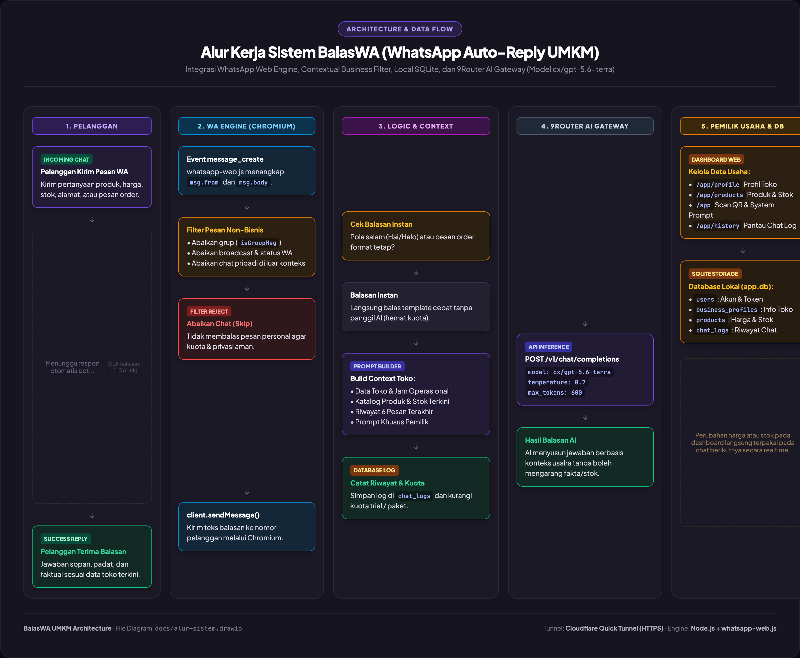
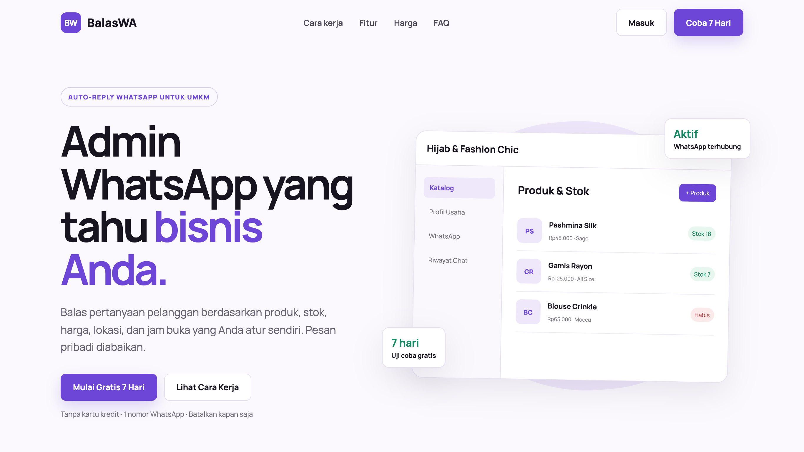
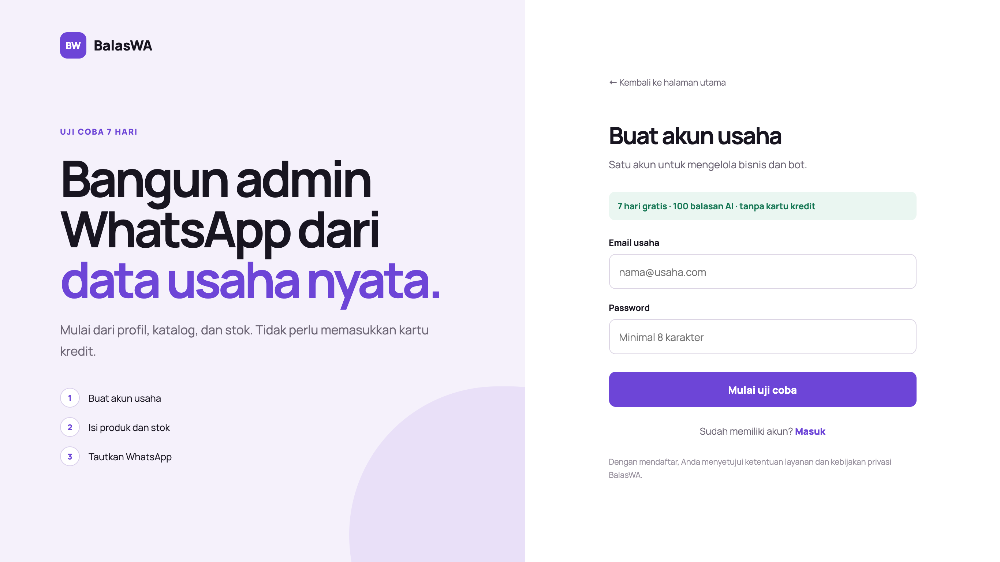
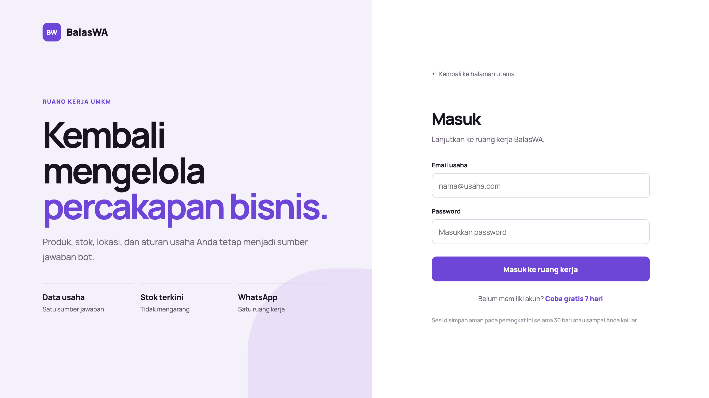
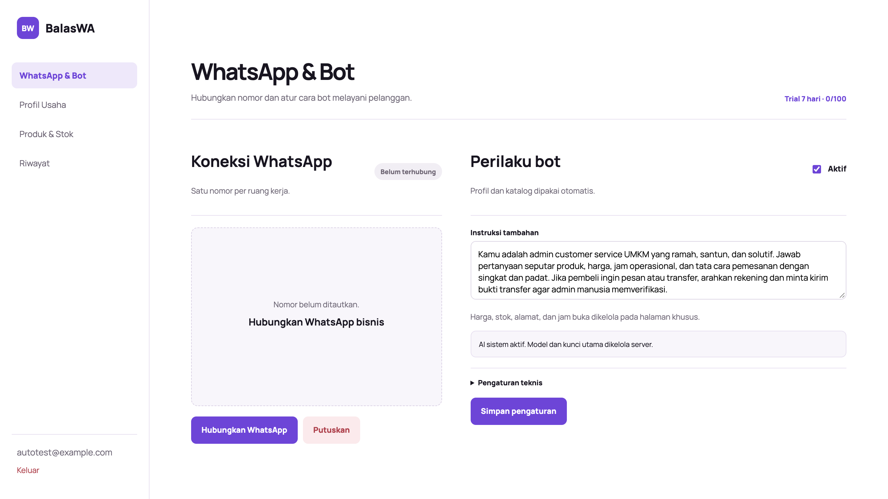
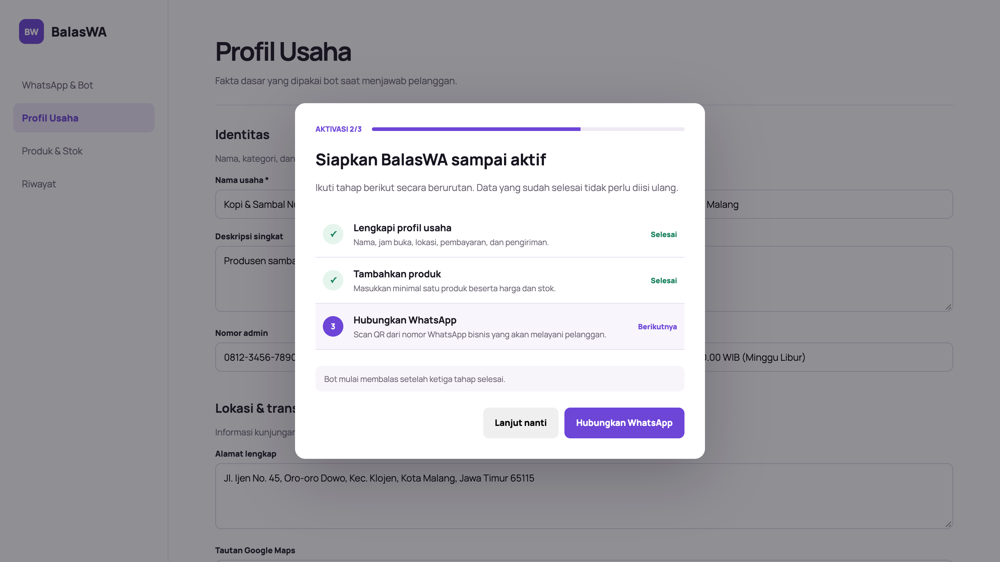
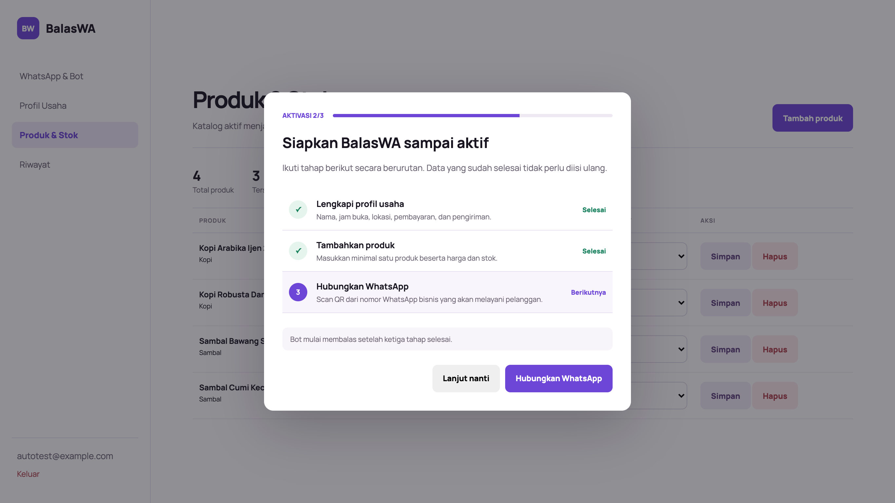
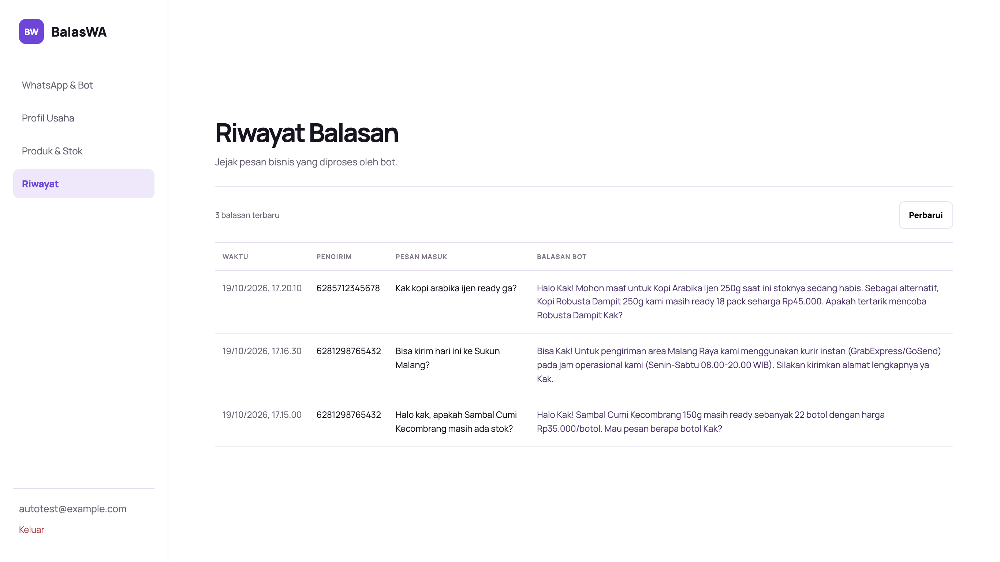
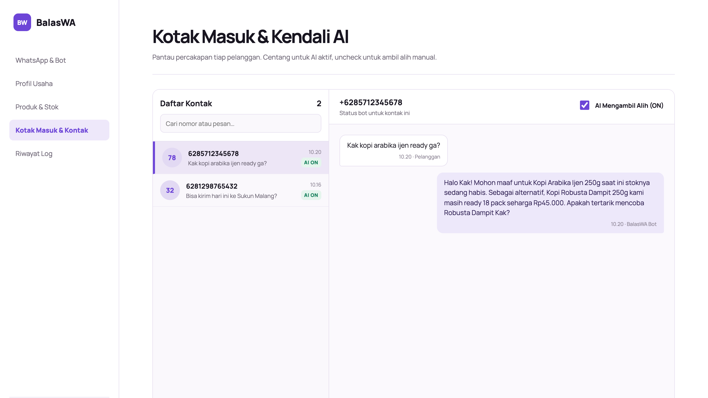

# Dokumentasi Sistem BalasWA (WhatsApp Auto-Reply UMKM)

BalasWA adalah platform asisten WhatsApp otomatis untuk pelaku UMKM. Bot menjawab pertanyaan pelanggan secara cerdas dan kontekstual berdasarkan data riil usaha (profil toko, jam buka, metode pembayaran, lokasi maps, serta katalog dan stok produk terkini) tanpa mengarang informasi (*no hallucination*).

---

## 1. Alur Sistem & Arsitektur

Diagram alur sistem dibuat dengan format standar **Draw.io** (`docs/alur-sistem.drawio`) dan diekspor ke gambar alur resolusi tinggi (`docs/screenshots/alur-sistem.png`).

### Tahapan Pemrosesan Pesan:
1. **Incoming Message (Pelanggan)**:
   - Pelanggan mengirimkan pesan teks ke nomor WhatsApp bisnis.
2. **Deteksi Pesan (WhatsApp Web Engine)**:
   - `whatsapp-web.js` berbasis Chromium menangkap event `message_create`.
3. **Filter Relevansi Bisnis**:
   - Sistem otomatis mengabaikan pesan grup (`isGroupMsg`), status WA, broadcast, atau pesan pribadi non-bisnis. Hal ini menjaga privasi serta menghemat kuota balasan AI.
4. **Evaluasi Balasan Instan**:
   - Pesan pembuka umum (seperti *"Hai Kak"*, *"Halo admin"*) atau frasa pemesanan cepat langsung dibalas dengan template instan tanpa memanggil API LLM.
5. **Context Builder**:
   - Bila pertanyaan memerlukan pemahaman mendalam, sistem merangkai konteks secara dinamis:
     - Profil toko (alamat, jam kerja, rekening pembayaran, aturan kirim).
     - Katalog produk aktif & ketersediaan stok aktual.
     - 6 riwayat obrolan terakhir pelanggan tersebut.
     - Instruksi tambahan/sapaan khusus dari pemilik.
6. **Inference AI Gateway (9Router)**:
   - Request dikirim ke 9Router (`https://r9ycqtl.abc-tunnel.us/v1/chat/completions`) menggunakan model `cx/gpt-5.6-terra`.
7. **Pengiriman Balasan & Logging**:
   - Bot mengirimkan jawaban ke pelanggan via WhatsApp, mencatat transkrip ke tabel `chat_logs` di SQLite, dan memperbarui kuota penggunaan.

---

## 2. Dokumentasi Halaman Web

Berikut adalah tangkapan layar dan penjelasan fitur dari setiap halaman aplikasi:

### 2.1 Halaman Utama (Landing Page)
URL: `/`

* **Fitur**: Informasi pengenalan produk, nilai tambah untuk UMKM, langkah aktivasi 3 tahap, daftar paket langganan (Trial 7 hari, Starter, Tumbuh), dan FAQ.

---

### 2.2 Pendaftaran Akun (Register)
URL: `/register`

* **Fitur**: Pembuatan akun usaha baru tanpa memerlukan kartu kredit. Setiap pendaftar baru langsung mendapatkan kuota uji coba (trial) gratis 7 hari (100 balasan AI).

---

### 2.3 Masuk Akun (Login)
URL: `/login`

* **Fitur**: Autentikasi aman menggunakan bcrypt hash dan sesi persisten berbasis SQLite cookie session store.

---

### 2.4 Dashboard WhatsApp & Bot
URL: `/app`

* **Fitur**:
  - Tautan sesi WhatsApp Web via scan QR Code.
  - Sakelar aktivasi/nonaktif bot.
  - Kustomisasi instruksi tambahan (sapaan, nada bicara, aturan transfer).
  - Status pemakaian kuota trial/langganan.
  - Pengaturan teknis API 9Router (model AI, endpoint base URL, dan custom API key).

---

### 2.5 Profil Usaha
URL: `/app/profile`

* **Fitur**: Input data operasional UMKM yang menjadi basis pengetahuan (*knowledge base*) bot:
  - Identitas usaha: Nama toko, kategori usaha, nomor WhatsApp admin manusia.
  - Operasional: Hari dan jam buka toko.
  - Lokasi & Pengiriman: Alamat lengkap, URL Google Maps, serta kebijakan kurir instan/ekspedisi.
  - Transaksi: Rekening bank transfer dan instruksi pembayaran QRIS.

---

### 2.6 Katalog Produk & Stok
URL: `/app/products`

* **Fitur**:
  - Manajemen katalog (Nama produk, SKU, kategori, harga, satuan).
  - Kontrol stok realtime: bila stok diubah menjadi `0`, bot otomatis menyampaikan bahwa produk sedang habis dan menawarkan varian lain.
  - Pengaturan status aktif/nonaktif produk di bot.
  - Ringkasan metrik total produk, produk tersedia, dan produk habis.

---

### 2.7 Riwayat Chat (Chat Logs)
URL: `/app/history`

* **Fitur**: Transparansi percakapan antara pelanggan dan bot. Pemilik usaha dapat mengevaluasi akurasi jawaban bot serta memeriksa kebutuhan pelanggan secara langsung.

---

### 2.8 Kotak Masuk & Kendali AI per Kontak
URL: `/app/chats`

* **Fitur**:
  - Tampilan percakapan ala WhatsApp Web dua kolom (Daftar kontak di kiri, thread percakapan di kanan).
  - Sakelar Kendali AI per Kontak: Bila dicentang (`AI ON`), pesan pelanggan dibalas otomatis oleh bot. Bila di-uncheck (`MANUAL`), AI tidak membalas pesan dari nomor tersebut sehingga pemilik/admin manusia dapat mengambil alih diskusi secara langsung tanpa interupsi bot.
  - Pencarian kontak berdasarkan nomor telepon atau cuplikan isi pesan.
  - Pembaruan realtime via polling otomatis.

---

## 3. Spesifikasi Teknis & Deployment

* **Backend & Runtime**: Node.js v25 + Express + SQLite (`node:sqlite`).
* **WhatsApp Driver**: `whatsapp-web.js` + Chromium (`/usr/bin/google-chrome-stable`).
* **LLM Engine**: 9Router API (`https://r9ycqtl.abc-tunnel.us/v1`), model `cx/gpt-5.6-terra`.
* **Public Access**: Cloudflare Quick Tunnel (HTTPS publik).
* **Systemd User Services**:
  - `bales-wa.service`: Menjalankan aplikasi web & backend bot di port 3000.
  - `bales-wa-tunnel.service`: Menjaga koneksi Cloudflare Tunnel tetap aktif dengan auto-restart.

### Berkas Terkait:
- File Diagram Draw.io: [`docs/alur-sistem.drawio`](docs/alur-sistem.drawio)
- Tangkapan Layar Flowchart: [`docs/screenshots/alur-sistem.png`](docs/screenshots/alur-sistem.png)
- Seluruh Tangkapan Layar Halaman: Folder [`docs/screenshots/`](docs/screenshots/)
